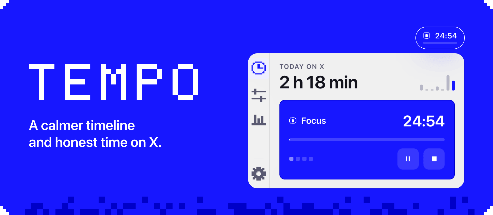
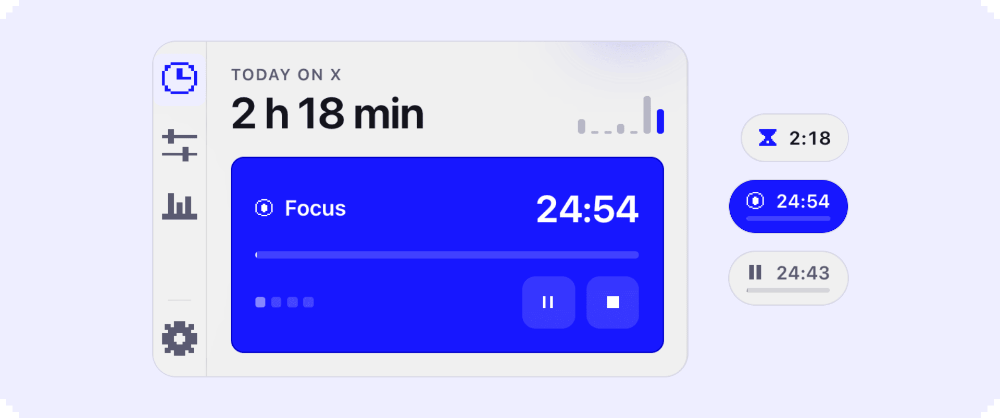
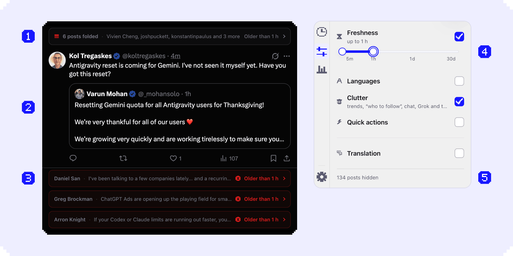
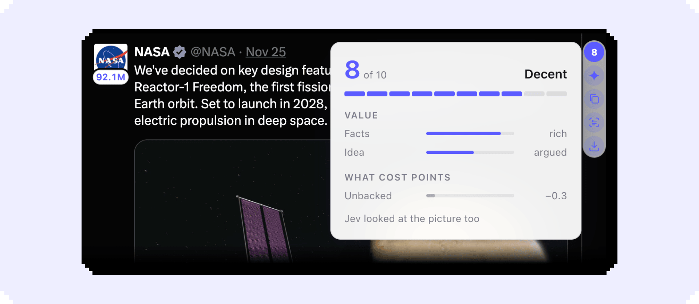

<p align="center">
  
</p>

<p align="center">
  <b>English</b> · <a href="README.ru.md">Русский</a>
</p>

<p align="center">
  <a href="https://github.com/vilikiy-ben/tempo-for-x/releases/latest"></a>
  <a href="LICENSE"></a>
</p>

Tempo is a free Chrome extension for [x.com](https://x.com) (formerly Twitter). It shows how much time you spend on X, folds away posts you don't need, translates the rest and adds a column of useful buttons to every post.

It's built for people who spend part of the working day on X: people who run a channel or a newsletter, researchers, marketers, anyone who reads X for work and wants to know where the hours went.

Everything is off after you install it, so you turn on only what you want. Tempo has no server, no account and no analytics, and it never posts, likes or follows anything for you.

## What it does

### Time and focus

A small label in the corner of X shows your time on X today, a running focus session or a pause. Time counts only while an X tab is visible, and with several X tabs open only the one you used last is counted.

Click the label (or press `Alt+T`) to open the panel. Its Time section has today's total, the last seven days and a Pomodoro timer: 25 minutes of focus, then a short break, with a long break after every fourth focus. The timer keeps running after you close the tab, and each phase change plays two short notes. The Stats section shows the last month by day and your usual hours.

<p align="center"></p>

### A quieter timeline

<p align="center"></p>

1. A stack. Five or more folded posts in a row become one line with their number and authors. Click it to unfold them.
2. A post that passed the filters stays exactly as X shows it.
3. A folded post keeps its author, first line and the reason it was folded. Click it to open the post.
4. The freshness filter keeps posts within the age range you set, here up to an hour old.
5. How many posts the filters have folded on this page.

The language filter works the same way: pick the languages you read, and Tempo suggests the ones it has met in your timeline. Filters work only in the home timeline, so profiles, bookmarks, search and conversations stay as they are. Tempo folds only posts that are off screen, so the line you are reading never jumps.

Clutter cleanup removes "What's happening", "Who to follow", "Today's News", the chat and Grok buttons and the footer links. Translation turns the timeline into English or Russian right where the text is, and a small language label brings the original back.

### Buttons on every post

<p align="center"></p>

1. The author's follower count, taken from data X has already loaded.
2. Junk meter: a score from 0 to 10 for how much substance the post has.
3. Explain: a model tells you what the post is about.
4. Copy text, with long posts expanded and shortened links replaced by full addresses.
5. Copy as image.
6. Download media in original size, videos included.

On the home timeline the column also has "Not interested" and "Block". They press the same items in X's own menu that you would, and Block asks you to confirm.

**Copy as image** draws a clean card of the post at double resolution and puts the PNG on your clipboard, ready to paste into a chat or a channel. Pick its look in Settings: your X theme, light, dark or a random colour. Shift-click saves it to Downloads instead.

<p align="center"></p>

**Junk meter** gets its score from Jev by [TypeSafe](https://typesafe.ai) with your own API key and shows what added value and what cost points. A post is sent only when you press the button.

<p align="center"></p>

**Explain** answers in a small window next to the post. The model sees the text, images, the quoted post and the replies X has loaded, and can search the web first. It runs through [Codex CLI](https://developers.openai.com/codex/cli) on your computer with your ChatGPT subscription, so there is no API key to buy.

## Install

1. Download the zip from [Releases](https://github.com/vilikiy-ben/tempo-for-x/releases/latest) and unzip it into a folder you will keep. Chrome loads the extension from that folder every time.
2. Open `chrome://extensions`, turn on **Developer mode** and click **Load unpacked**.
3. Choose the unzipped folder and open [x.com](https://x.com). The label appears in the corner, and the first time the panel opens by itself.

To build from source instead (Node 22 or newer):

```bash
git clone https://github.com/vilikiy-ben/tempo-for-x.git
cd tempo-for-x
npm ci && npm run build
```

Then load the `dist` folder, not the repository root.

`Alt+T` opens the panel, `Alt+Shift+F` starts or pauses focus, `Esc` closes the panel. You can drag the label to any corner.

### Junk meter and Explain

Both are optional.

**Junk meter:** create a key in the [TypeSafe console](https://console.typesafe.ai/settings/keys), paste it under Settings → Junk meter and turn on Quick actions in the Feed section.

**Explain** (macOS and Linux) needs [Codex CLI](https://developers.openai.com/codex/cli) and a small local bridge:

```bash
node scripts/agent-install.mjs                  # from this repository
node scripts/agent-install.mjs <extension-id>   # if you loaded a release zip
```

Restart Chrome, then open Settings → Agent mode → Sign in with ChatGPT. To remove the bridge, run `node scripts/agent-install.mjs --uninstall`.

## Questions

**Chrome says "Could not load javascript 'harvest.js'".** You picked the repository root. Pick the `dist` folder, or the unzipped release folder.

**I don't see the label.** Reload the X tab after installing and check that Tempo is switched on in `chrome://extensions`.

**Does it work in Firefox or Safari?** No, only in Chrome and other Chromium browsers (Edge, Brave, Arc, Vivaldi).

## License

[MIT](LICENSE). Tempo isn't affiliated with X Corp., OpenAI or TypeSafe.
