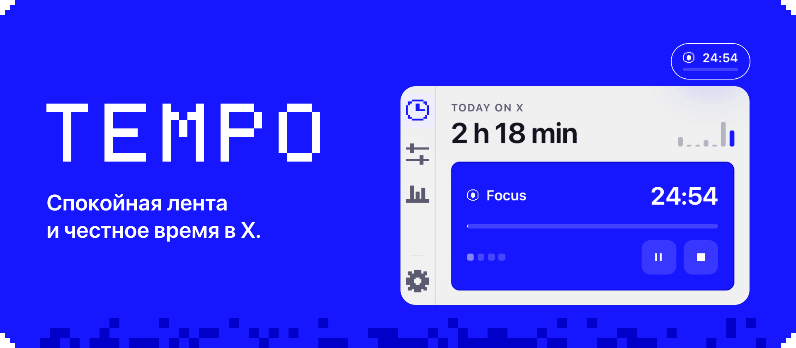
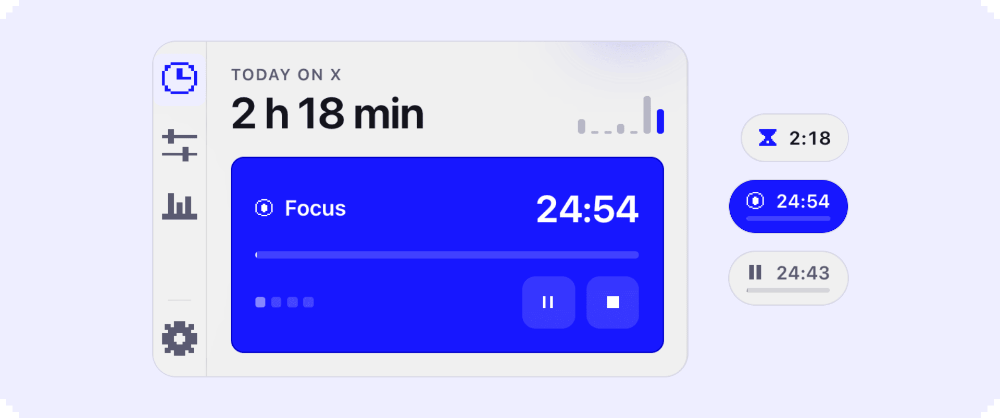
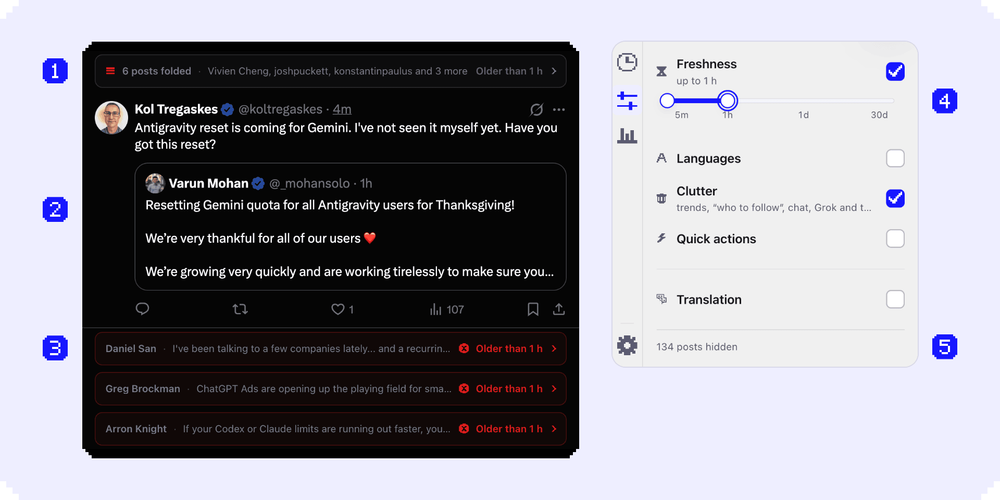
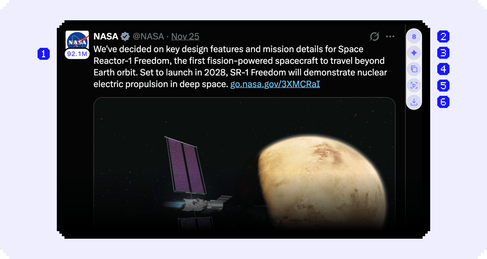
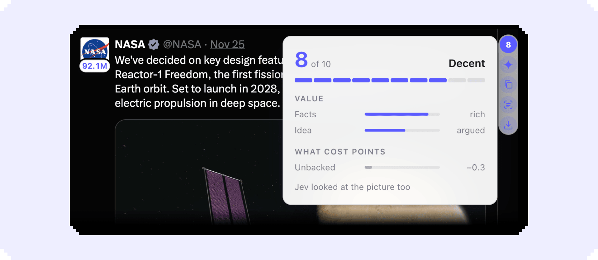

<p align="center">
  
</p>

<p align="center">
  <a href="README.md">English</a> · <b>Русский</b>
</p>

<p align="center">
  <a href="https://github.com/vilikiy-ben/tempo-for-x/releases/latest"></a>
  <a href="LICENSE"></a>
</p>

Tempo это бесплатное расширение Chrome для [x.com](https://x.com) (бывший Twitter). Оно показывает, сколько времени уходит на X, сворачивает ненужные посты, переводит остальные и ставит рядом с каждым постом столбик полезных кнопок.

Делалось оно для тех, у кого X занимает часть рабочего дня: для авторов каналов и рассылок, исследователей, маркетологов, для всех, кто читает X по работе и хочет понимать, куда уходят часы.

После установки всё выключено, и вы включаете только то, что нужно. У Tempo нет сервера, аккаунта и аналитики, и от вашего имени он ничего не публикует, не лайкает и ни на кого не подписывается.

## Что умеет

### Время и фокус

Маленькая метка в углу X показывает, сколько вы сегодня провели в X, идущий фокус или паузу. Время идёт, только пока вкладка X видна на экране, а если вкладок X несколько, считается та, с которой вы работали последней.

Нажатие на метку (или `Alt+T`) открывает панель. В разделе «Время» сегодняшний итог, последние семь дней и таймер помодоро: 25 минут фокуса, потом короткий перерыв, а после каждого четвёртого фокуса длинный. Таймер продолжает идти после закрытия вкладки, а при смене фазы звучат две короткие ноты. В разделе «Статистика» последний месяц по дням и ваши обычные часы.

<p align="center"></p>

На снимках интерфейс расширения английский, русский включается в «Настройках».

### Лента потише

<p align="center"></p>

1. Стопка. Пять и больше свёрнутых постов подряд становятся одной строкой с их числом и авторами. Нажатие разворачивает их.
2. Пост, прошедший фильтры, остаётся таким, каким его показывает X.
3. От свёрнутого поста остаётся автор, первая строка и причина, по которой он свёрнут. Нажатие открывает пост.
4. Фильтр свежести оставляет посты в заданном диапазоне возраста, здесь не старше часа.
5. Сколько постов фильтры свернули на этой странице.

Фильтр языков устроен так же: вы отмечаете языки, которые читаете, а встреченные в ленте Tempo предлагает сам. Фильтры работают только в главной ленте, так что профили, закладки, поиск и разговоры остаются как есть. Сворачивается только то, что вне экрана, поэтому строка, которую вы читаете, не прыгает.

Уборка мусора убирает «Что происходит», «Кого читать», «Новости дня», кнопки чата и Grok и ссылки подвала. Перевод переводит ленту на русский или английский прямо на месте, а маленькая метка языка возвращает оригинал.

### Кнопки у каждого поста

<p align="center"></p>

1. Число подписчиков автора, взятое из данных, которые X уже загрузил.
2. Детектор чуши: оценка от 0 до 10 того, сколько в посте содержания.
3. Разбор: модель объясняет, о чём пост.
4. Копировать текст: длинный пост раскрывается, сокращённые ссылки заменяются полными адресами.
5. Снимок в буфер.
6. Скачать медиа в исходном размере, видео тоже.

В главной ленте в столбике есть ещё «Не интересует» и «Заблокировать». Они нажимают те же пункты родного меню X, что нажали бы вы, а блокировка переспрашивает.

**Снимок в буфер** рисует чистую карточку поста в двойном разрешении и кладёт PNG в буфер обмена, откуда его можно вставить в чат или канал. Вид выбирается в «Настройках»: как тема X, светлый, тёмный или случайного цвета. Shift-щелчок вместо буфера сохраняет картинку в «Загрузки».

<p align="center"></p>

**Детектор чуши** берёт оценку у Jev от [TypeSafe](https://typesafe.ai) по вашему ключу и показывает, что прибавило посту ценности и что стоило баллов. Пост отправляется только по нажатию.

<p align="center"></p>

**Разбор** отвечает в небольшом окне рядом с постом. Модель видит текст, картинки, цитируемый пост и ответы, которые загрузил X, и при необходимости ищет в сети. Работает он через [Codex CLI](https://developers.openai.com/codex/cli) на вашем компьютере по подписке ChatGPT, так что покупать ключ API не нужно.

## Установка

1. Скачайте архив со страницы [релизов](https://github.com/vilikiy-ben/tempo-for-x/releases/latest) и распакуйте в папку, которая останется на месте: Chrome каждый раз загружает расширение из неё.
2. Откройте `chrome://extensions`, включите **«Режим разработчика»** и нажмите **«Загрузить распакованное»**.
3. Выберите распакованную папку и откройте [x.com](https://x.com). Метка появится в углу, а в первый раз панель откроется сама.

Собрать из исходников (Node 22 или новее):

```bash
git clone https://github.com/vilikiy-ben/tempo-for-x.git
cd tempo-for-x
npm ci && npm run build
```

Затем загрузите папку `dist`, а не корень репозитория.

`Alt+T` открывает панель, `Alt+Shift+F` запускает или ставит на паузу фокус, `Esc` закрывает панель. Метку можно перетащить в любой угол.

### Детектор чуши и разбор

Обе функции необязательны.

**Детектор чуши:** создайте ключ в [консоли TypeSafe](https://console.typesafe.ai/settings/keys), вставьте его в «Настройках» → «Детектор чуши» и включите «Быстрые действия» в разделе «Лента».

**Разбору** (macOS и Linux) нужен [Codex CLI](https://developers.openai.com/codex/cli) и небольшой локальный мост:

```bash
node scripts/agent-install.mjs                  # из этого репозитория
node scripts/agent-install.mjs <id-расширения>  # если Tempo загружен из архива релиза
```

Перезапустите Chrome и откройте «Настройки» → «Режим агента» → «Войти в ChatGPT». Снять мост: `node scripts/agent-install.mjs --uninstall`.

## Вопросы

**Chrome пишет «Could not load javascript 'harvest.js'».** Выбран корень репозитория. Нужна папка `dist` или распакованная папка релиза.

**Метки не видно.** Перезагрузите вкладку X после установки и проверьте, что Tempo включён в `chrome://extensions`.

**Работает ли в Firefox или Safari?** Нет, только в Chrome и других браузерах на Chromium (Edge, Brave, Arc, Vivaldi).

## Лицензия

[MIT](LICENSE). Tempo не связан с X Corp., OpenAI или TypeSafe.
